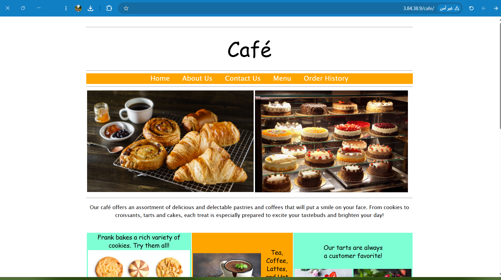
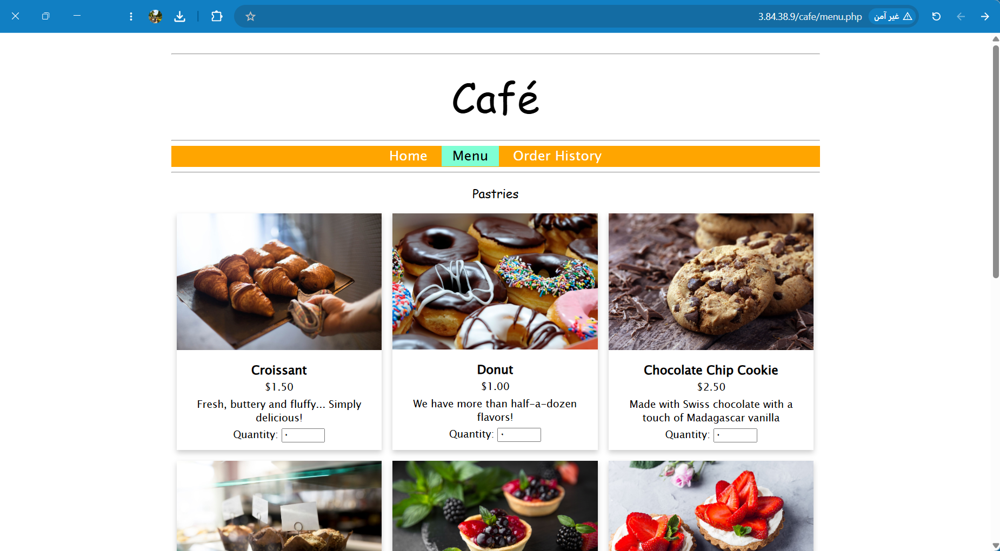
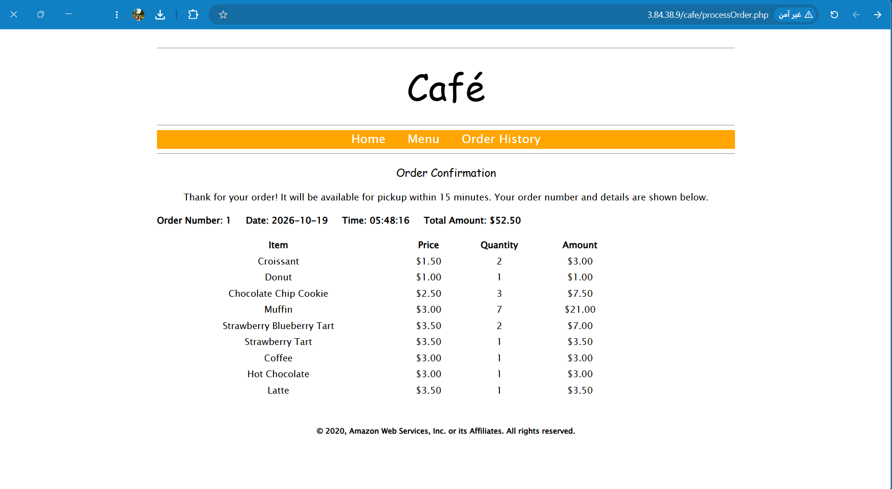
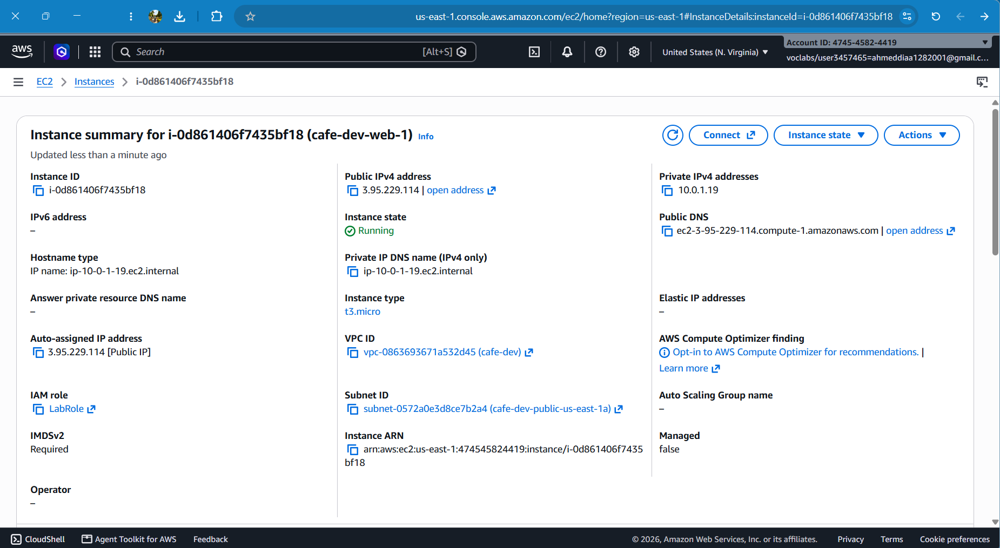
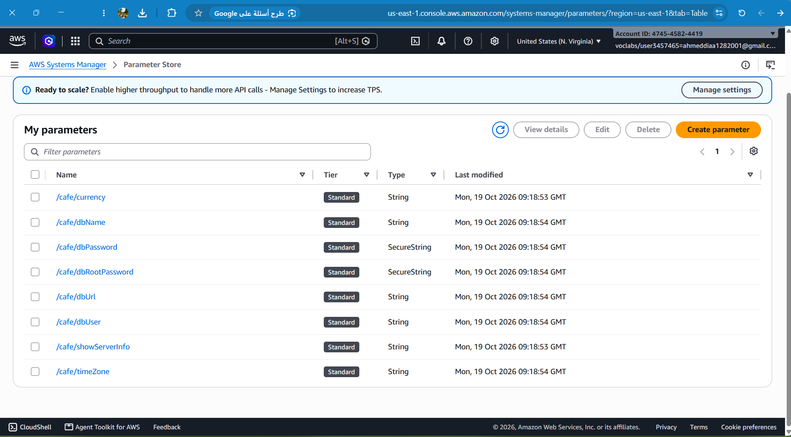

# V2 – Dynamic Website on Amazon EC2

**Business reason:** Update the website to support dynamic content and online ordering.

## Architecture

```
Internet ──HTTP:80──► EC2 (Apache + PHP + MariaDB) in a public subnet
                          │
                          └──► SSM Parameter Store (app settings and DB passwords)
```

- One EC2 instance (`t3.micro`, Amazon Linux 2023) in a public subnet of the `cafe-dev` VPC
- Web application and database run on the same instance (they are separated in V3)
- Application configuration and DB credentials are stored in **SSM Parameter Store**
- The instance reads them at runtime through the `LabInstanceProfile` (no access keys on the server)

## Infrastructure as Code

Deployed with Terraform from `terraform/environments/dev` (26 resources):

| Module | Creates |
|---|---|
| `network` | VPC, 2 public + 2 private subnets, Internet Gateway, route tables |
| `security-groups` | ALB, web and DB security groups (the ALB group is unused until V5) |
| `compute` | EC2 instance, IMDSv2 enforced, `LabInstanceProfile`, `vockey` key pair |
| `ssm-parameters` | Application parameters and two random DB passwords |

Network access:
- HTTP (80) open to the internet, because there is no load balancer yet
- SSH (22) restricted to the administrator's public IP (`/32`)

## Application

The café application comes from the AWS Academy lab materials. I changed it as follows:

| Original | This project |
|---|---|
| Secrets Manager (not available in the sandbox) | **SSM Parameter Store**, using `SsmClient` and `getParameter` with decryption |
| Hard-coded DB password in lab scripts | **Random 20-character passwords** generated by Terraform (`random_password`) |
| DB user `admin@'%'` with `ALL` on `*.*` | `admin@'localhost'` with privileges on `cafe_db` only (least privilege) |
| `dbUrl` = instance public DNS | `localhost` (the DB runs on the same instance) |
| Apache on port 8000 (needed only by the lab IDE) | Apache on the default port 80 |

Modified file: [`app/dynamic-website-v2/getAppParameters.php`](../app/dynamic-website-v2/getAppParameters.php)

### SSM parameters

| Parameter | Type |
|---|---|
| `/cafe/dbPassword` | SecureString |
| `/cafe/dbRootPassword` | SecureString |
| `/cafe/dbUrl`, `/cafe/dbName`, `/cafe/dbUser` | String |
| `/cafe/currency`, `/cafe/timeZone`, `/cafe/showServerInfo` | String |

## Deployment note

The infrastructure was created with Terraform. **The application was deployed manually over SSH** to validate each step before automating it. Ansible roles that automate these steps are part of **V3**.

Manual steps performed on the instance:

1. Install `httpd`, `php`, `php-mysqlnd`, and `mariadb105-server`; enable both services.
2. Download and extract the café application into `/var/www/html/cafe` and fetch `aws.phar` (AWS SDK for PHP).
3. Replace `getAppParameters.php` with the SSM-based version.
4. Read the DB passwords from SSM, create the `cafe_db` database from `create-db.sql`, and create the `admin` user with the SSM password.
5. Set `date.timezone` in `php.ini` and restart Apache.

## Result

| | |
|---|---|
| Home page |  |
| Menu (data read from MariaDB) |  |
| Order confirmation (written to MariaDB) |  |
| EC2 instance |  |
| SSM parameters |  |

## Limitations and next steps

- **Single point of failure:** one instance hosts both the app and the database. V3 moves the database to RDS in a private subnet.
- **Manual deployment:** not repeatable. V3 introduces Ansible to automate it.
- **Terraform state contains the generated passwords in plain text.** The state is local and git-ignored. A production setup would use an encrypted remote backend.
- **SSM paths are not environment-scoped** (`/cafe/...`), so dev and prod cannot run in the same account at the same time.
- **HTTP only,** no TLS.
- The SSH rule depends on the administrator's public IP, which changes over time and must be updated in `terraform.tfvars`.