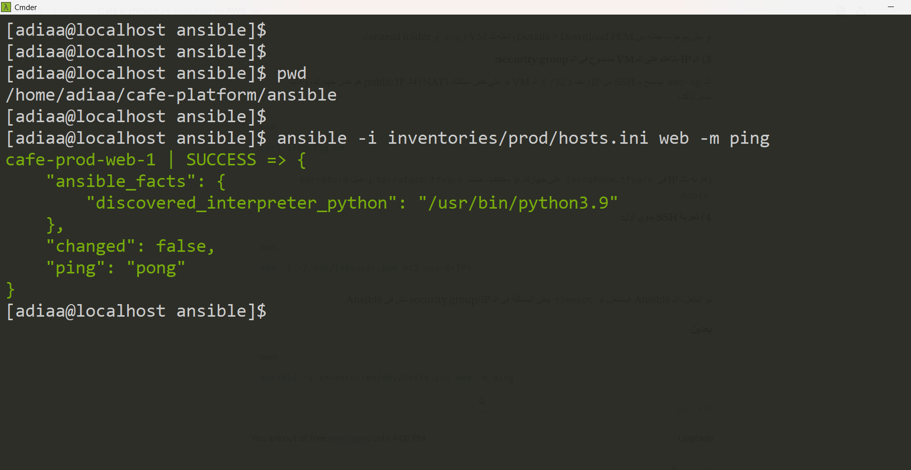
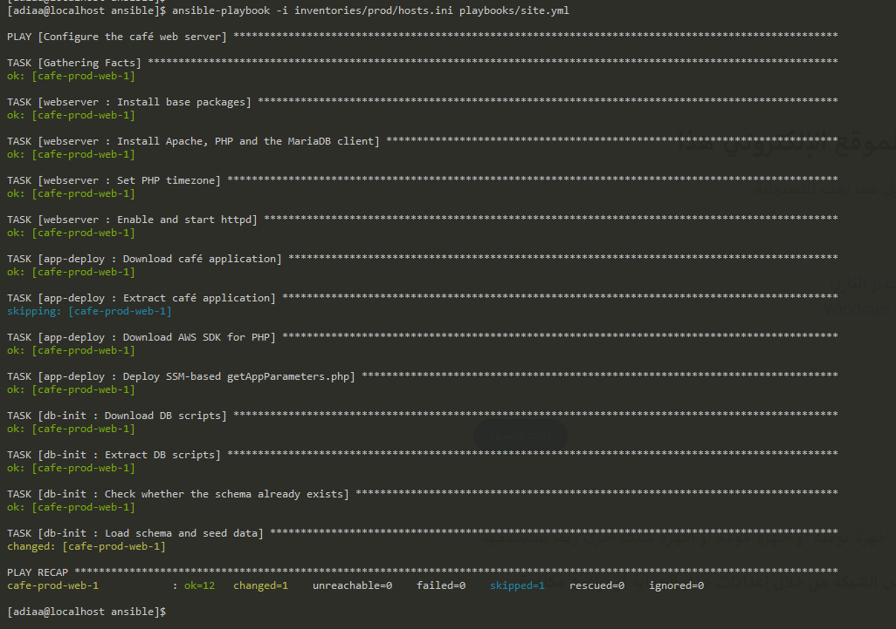
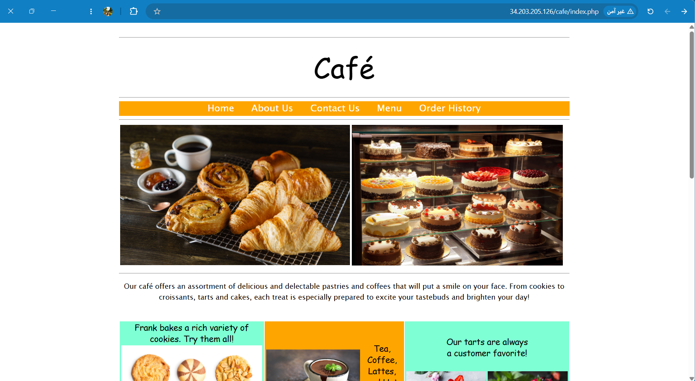
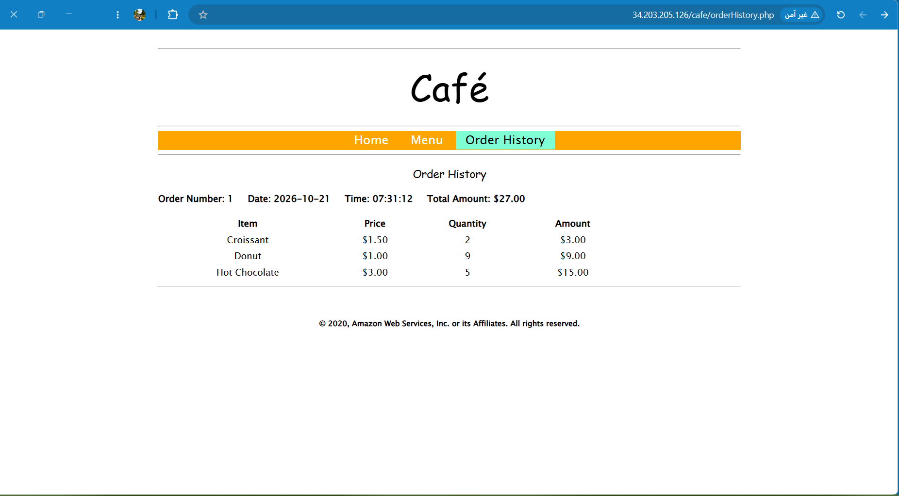
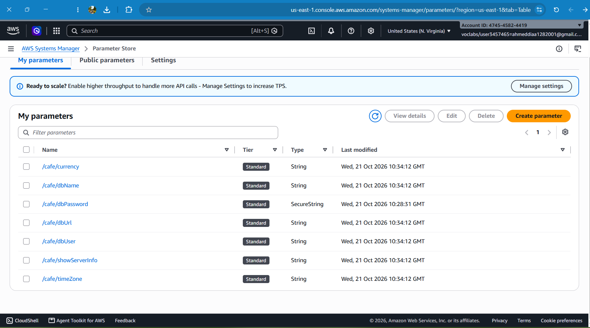
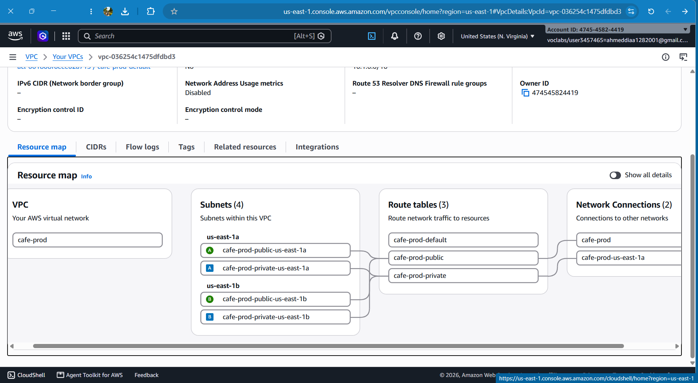

# V3 – Separate Web and Database Layers (EC2 + RDS) with Ansible

**Business reason:** Reduce the effort of maintaining the database and secure its data.

## Architecture

```
Internet ──HTTP:80──► EC2 (Apache + PHP)   public subnet, us-east-1a
                          │
                          │ MySQL :3306 (db-sg accepts only web-sg)
                          ▼
                      RDS MariaDB 10.11     private subnets (2 AZs), not publicly accessible

Admin workstation ──SSH──► EC2   (Ansible)
Application ──────────────► SSM Parameter Store (settings + DB password)
```

- The web tier stays on a single EC2 instance in a public subnet.
- The database moved from the instance to **Amazon RDS (MariaDB)** in private subnets.
- RDS is not publicly accessible. Its security group (`db-sg`) accepts port 3306 **only from the web security group**.
- Storage encryption at rest is enabled on the RDS instance.

## Infrastructure as Code (Terraform)

Deployed from `terraform/environments/<env>`:

| Module | Creates |
|---|---|
| `network` | VPC, 2 public + 2 private subnets, Internet Gateway, route tables |
| `security-groups` | ALB, web and DB security groups (ALB group unused until V5) |
| `compute` | EC2 instance with `LabInstanceProfile` and IMDSv2 enforced |
| `database` (new) | RDS subnet group and a MariaDB instance (single-AZ) |
| `ssm-parameters` | Application parameters, including the RDS endpoint as `/cafe/dbUrl` |

### Design decision: where the DB password is generated

The password is generated by a `random_password` resource in the **root module** and passed to both `database` and `ssm-parameters`. Generating it inside `ssm-parameters` created a dependency cycle:

```
ssm-parameters needs database.address  (for /cafe/dbUrl)
database needs the password            (from ssm-parameters)
```

Terraform rejects cycles, so the shared value moved up to the root.

### Sandbox constraints

- `multi_az = false` and `monitoring_interval = 0` (not supported in the AWS Academy sandbox).
- RDS module written with plain resources instead of a community module, to keep full control over what is created in a restricted account.

## Configuration management (Ansible)

Ansible connects to the EC2 instance over SSH. It does not connect to RDS directly (private subnet, managed service); the EC2 instance reaches RDS from inside the VPC.

```
ansible/
├── ansible.cfg
├── inventories/{dev,prod}/hosts.ini
├── inventories/{dev,prod}/group_vars/all.yml
├── playbooks/site.yml
└── roles/
    ├── webserver/    Apache, PHP, MariaDB client, php.ini timezone
    ├── app-deploy/   café application, AWS SDK, SSM-based getAppParameters.php
    └── db-init/      loads the schema into RDS (only if it does not exist yet)
```

Key points:
- **Secrets are not stored in the repo.** `group_vars` read the DB endpoint, user, name and password from SSM Parameter Store at run time.
- **Idempotent.** `db-init` checks whether the `product` table exists before loading `create-db.sql`, because the script drops and recreates the database.
- **Environment is chosen with `-i`.** `ansible.cfg` has no default inventory, so a command cannot run against the wrong environment by accident.
- **Tags** (`web`, `app`, `db`) allow running one part of the playbook.

```bash
ansible -i inventories/prod/hosts.ini web -m ping
ansible-playbook -i inventories/prod/hosts.ini playbooks/site.yml
```

## Result

| | |
|---|---|
| Ansible connectivity (`ping`) |  |
| Playbook run (`failed=0`) |  |
| Home page |  |
| Order History (read from RDS) |  |
| SSM parameters |  |
| VPC resource map (`cafe-prod`) |  |

The validation ran on the `prod` environment (one environment at a time in the sandbox).

## Issues encountered

| Issue | Cause | Resolution |
|---|---|---|
| Terraform `Cycle` error | `database` and `ssm-parameters` depended on each other | Generate the password in the root module |
| `Missing required argument db_password` | New module variable not passed by the environment | Pass it from `random_password` |
| `ansible web -m ping` found no hosts | No default inventory by design | Use `-i inventories/<env>/hosts.ini` |

## Limitations and next steps

- **Single EC2 instance and single-AZ RDS.** V5 adds an ALB, Auto Scaling and two AZs. Multi-AZ RDS is not available in the sandbox; in a regular account `multi_az = true` would be set.
- **No TLS** between the application and RDS, or between the client and the web server.
- **The web instance has a public IP and SSH open** to the administrator's IP. V4 tightens the network.
- **SSM paths are not environment-scoped** (`/cafe/...`), so dev and prod cannot coexist in one account.
- **The DB password is stored in the local Terraform state** (git-ignored). A production setup would use an encrypted remote backend.
- The password appears briefly in the process list during `db-init` (`mysql -p`); acceptable for a lab, a `~/.my.cnf` would be used in production.