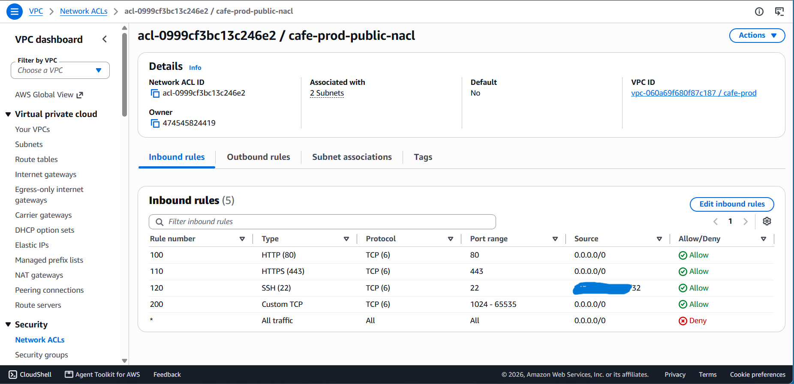
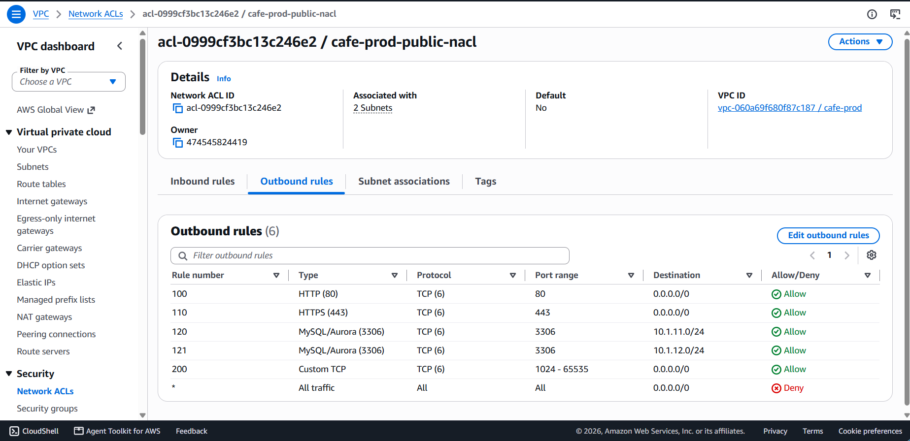
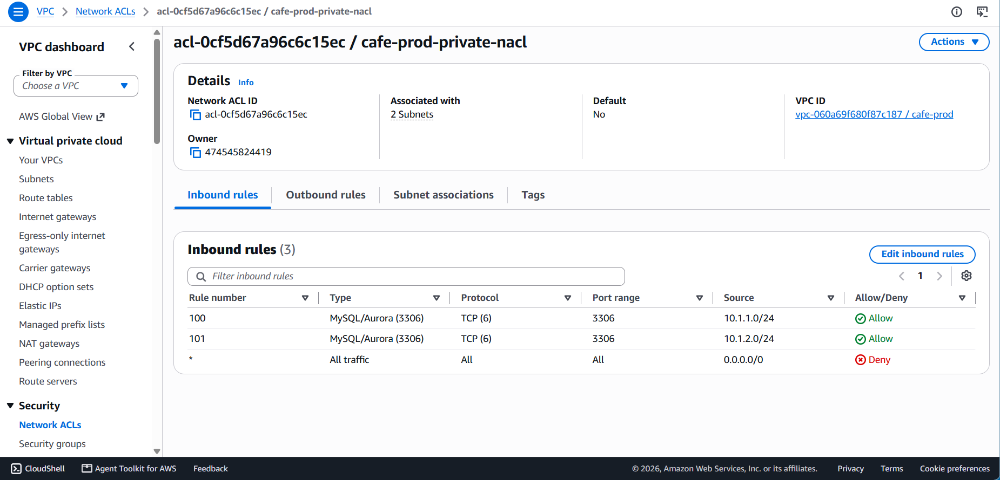
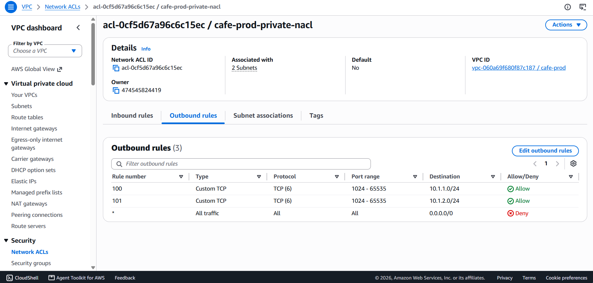
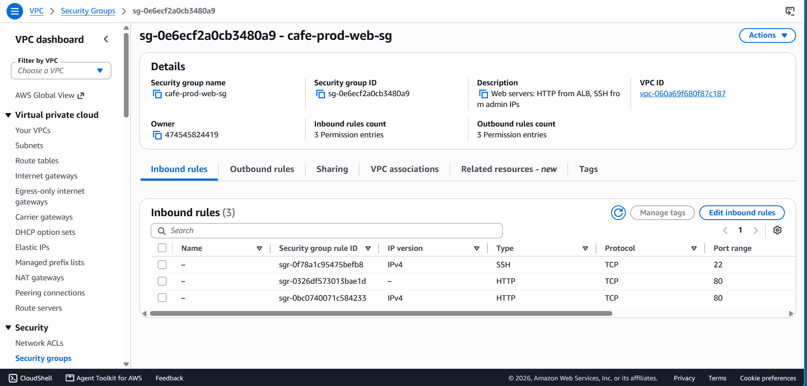
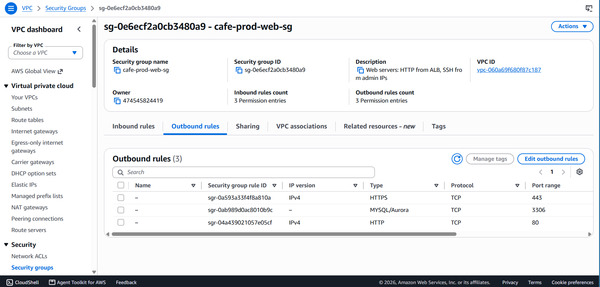
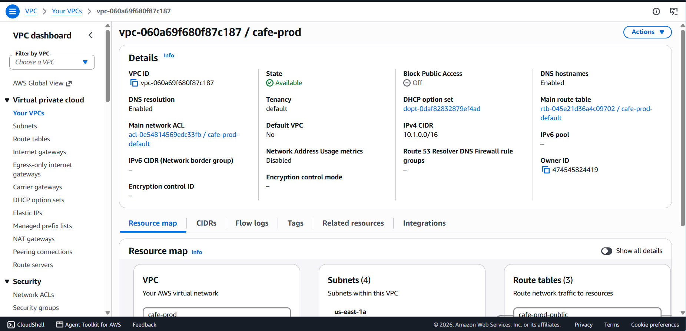

# V4 – Securing the Network with VPC Features

**Business reason:** Enhance the security of the web application.

## Architecture

```
Internet
   │  80/443 (+ SSH from admin IP)
   ▼
┌─ Public subnets ── Public NACL ─────────────────┐
│  EC2 (Apache + PHP)    web-sg                    │
└───────────────┬─────────────────────────────────┘
                │ 3306 only
┌───────────────▼─ Private subnets ── Private NACL ┐
│  RDS MariaDB           db-sg                      │
└───────────────────────────────────────────────────┘
```

Two independent layers of filtering (defense in depth):

| Layer | Scope | Stateful | Default in this project |
|---|---|---|---|
| **Network ACL** | Subnet | No (every packet is evaluated) | Custom, default-deny |
| **Security Group** | Instance / ENI | Yes | Least-privilege egress |

## Network ACLs (new `nacl` module)

**Public subnets**

| Direction | Rule | Port | Peer |
|---|---|---|---|
| Inbound | 100 | 80 | `0.0.0.0/0` |
| Inbound | 110 | 443 | `0.0.0.0/0` |
| Inbound | 120 | 22 | administrator IP `/32` |
| Inbound | 200 | 1024-65535 | `0.0.0.0/0` (replies to outbound requests) |
| Outbound | 100 / 110 | 80 / 443 | `0.0.0.0/0` (`dnf`, SSM API, downloads) |
| Outbound | 120 / 121 | 3306 | private subnets |
| Outbound | 200 | 1024-65535 | `0.0.0.0/0` (replies to clients) |

**Private subnets**

| Direction | Rule | Port | Peer |
|---|---|---|---|
| Inbound | 100 / 101 | 3306 | public subnets only |
| Outbound | 100 / 101 | 1024-65535 | public subnets only (replies) |

Everything else hits the implicit `*` deny rule.

**Why ephemeral ports:** NACLs are stateless. A reply goes to the client's random (ephemeral) source port, not to port 80 or 22, so the reply direction needs its own rule. Forgetting it is the most common NACL mistake: requests arrive, replies are dropped, and connections time out.

Rule numbers are spaced (100, 110, 120, 200) so new rules can be inserted without renumbering.

## Security group hardening

Previously every group allowed all outbound traffic. Egress is now restricted:

| Security group | Inbound | Outbound |
|---|---|---|
| `alb-sg` (used from V5) | 80, 443 from the internet | 80 to `web-sg` |
| `web-sg` | 80 (direct, until the ALB exists), 80 from `alb-sg`, 22 from admin IP | 443 (SSM, downloads), 80 (`dnf`), 3306 to `db-sg` |
| `db-sg` | 3306 from `web-sg` only | **none** |

Notes:
- Egress rules are separate `aws_vpc_security_group_egress_rule` resources with no inline `egress` blocks. This keeps Terraform from leaving AWS's default allow-all rule in place, and avoids a dependency cycle between `web-sg` (egress to `db-sg`) and `db-sg` (ingress from `web-sg`).
- The default security group of the VPC has no rules (managed by the VPC module).
- DNS, the instance metadata service, and time sync use link-local addresses that security groups and NACLs do not filter, so they need no rules.

## Verification

| | |
|---|---|
| Public NACL, inbound |  |
| Public NACL, outbound |  |
| Private NACL, inbound |  |
| Private NACL, outbound |  |
| `web-sg`, inbound |  |
| `web-sg`, outbound (no allow-all) |  |
| VPC |  |

After applying, the application kept working end to end (menu and orders through port 80, RDS over 3306, parameters from SSM over 443), and Ansible still reached the instance over SSH.

## Additional attempt: VPC Flow Logs

Flow Logs were tried manually from the console with CloudWatch Logs as the destination, to verify REJECT traffic. The flow log status was *"Access error: The log destination is not accessible"*. The sandbox's `LabRole` trust policy does not include `vpc-flow-logs.amazonaws.com`, and IAM is read-only, so a suitable role cannot be created. It was therefore not added to Terraform. In a regular account a flow log with a dedicated IAM role (or an S3 destination) would be enabled.

## Limitations and next steps

- **The web instance still has a public IP** and SSH is open to one administrator IP. Session Manager would allow closing port 22, but Ansible needs SSH here.
- **The administrator IP changes** and must be updated in `terraform.tfvars` (it feeds both the NACL and the security group).
- **No WAF.** AWS WAF attaches to an ALB or CloudFront, not to EC2, so it belongs after V5 and may not be available in the sandbox.
- **No NAT Gateway yet.** It is needed when web servers move to private subnets behind the ALB (V5), and the NACLs will need updating then.
- **No TLS** on the web tier or to RDS.
- **No flow logs** (see above).