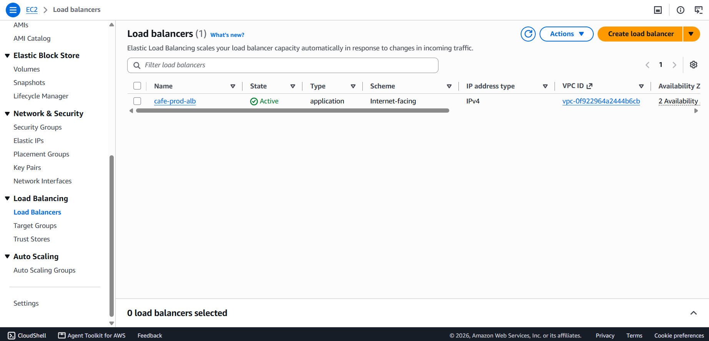
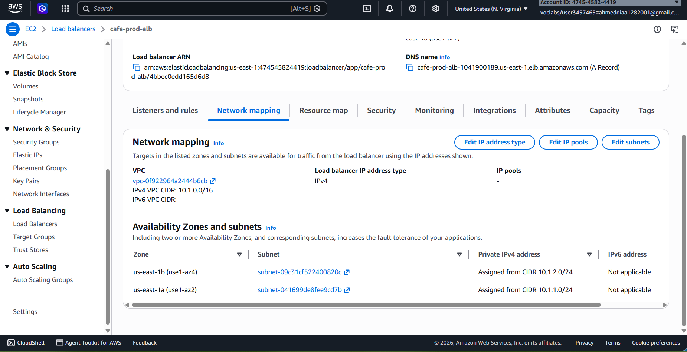
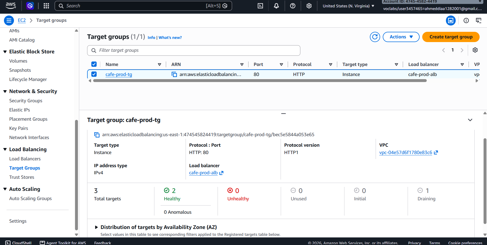
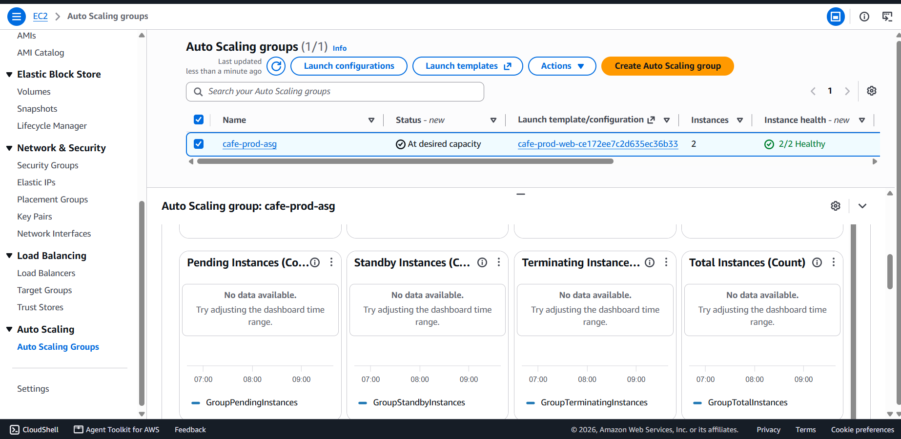
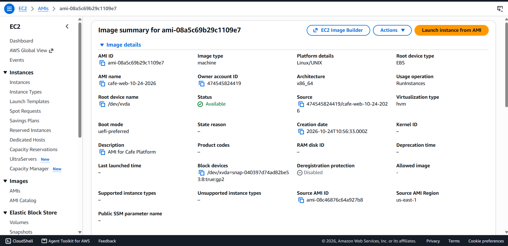
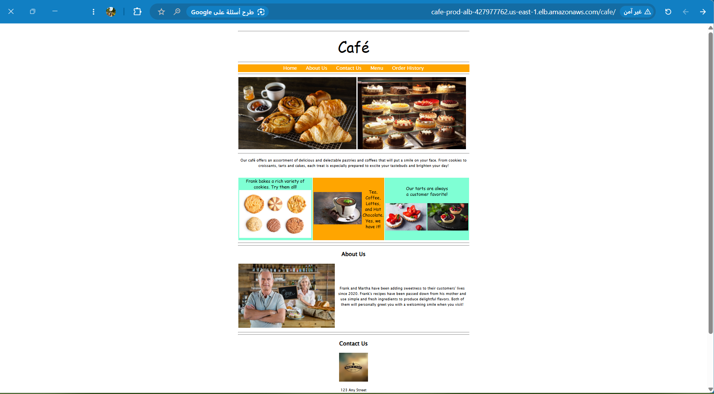

# V5 – High Availability: ALB, Auto Scaling and Two Availability Zones

**Business reason:** Ensure the website can handle an expected increase in traffic and remain highly available and resilient to failure.

## Architecture

```
                    Internet
                       │ HTTP :80
                       ▼
              ┌─────────────────┐
              │  ALB (alb-sg)   │  public subnets, us-east-1a + us-east-1b
              └───┬─────────┬───┘
        :80 (web-sg accepts only alb-sg)
         ┌────────▼──┐   ┌──▼────────┐
         │ EC2 (AZ-a)│   │ EC2 (AZ-b)│   Auto Scaling Group (min 2, max 3)
         └────────┬──┘   └──┬────────┘   Launch Template → custom AMI
                  └────┬────┘
                       │ MySQL :3306 (db-sg accepts only web-sg)
                       ▼
               RDS MariaDB (single-AZ, private subnets in 2 AZs)
```

## What changed from V4

| | V4 | V5 |
|---|---|---|
| Web tier | 1 instance | **2+ instances in 2 AZs, managed by an ASG** |
| Entry point | Instance public IP | **ALB DNS name** |
| `web-sg` HTTP rule | Open to the internet | **Only from `alb-sg`** |
| Instance provisioning | Ansible on a live server | **Custom AMI (golden image)** |
| Failure handling | Manual | **Automatic replacement** |

## Components (Terraform)

| Module | Creates |
|---|---|
| `alb` (new) | Application Load Balancer, target group (`/cafe/` health check), HTTP listener |
| `asg` (new) | Launch Template, Auto Scaling Group (`ELB` health checks, 2 AZs) |
| `security-groups` | Direct HTTP rule removed (`web_http_cidrs = []`); traffic enters only through the ALB |

The ASG registers instances in the target group itself, so there is no `target_group_attachment`. The `asg` module looks up the newest AMI named `cafe-web-*` tagged `Project=cafe-platform` (or takes an explicit `web_ami_id`).

## Image pipeline (AMI)

An ASG creates instances at any time, so every instance must be ready on its own. Instead of configuring servers at boot, the image is built once:

```
1. Terraform  → builder instance (the existing compute module)
2. Ansible    → ansible-playbook ... --tags web,app     (no db-init)
3. Console    → Create image  (name cafe-web-*, tag Project=cafe-platform)
4. Terraform  → ASG launches instances from the AMI
5. Terraform  → builder removed
```

**Why the schema is not part of this flow:** `create-db.sql` runs `DROP DATABASE`, and the data lives in RDS, not on the instance disk. Running it from every new instance would wipe customer orders whenever the ASG scales out or replaces a server. The schema is loaded **once**, manually, with `ansible-playbook ... --tags db`, and `db-init` also checks that the `product` table does not exist before loading.

The AMI contains no secrets: the application reads the DB endpoint and password from SSM Parameter Store at run time.

## Verification

| | |
|---|---|
| Load balancer |  |
| ALB spanning two AZs |  |
| Target group: healthy targets |  |
| Auto Scaling group: 2/2 healthy |  |
| AMI |  |
| Application through the ALB (`/cafe/`) |  |

## Issues encountered

| Issue | Cause | Resolution |
|---|---|---|
| ASG replaced instances in a loop | `health_check_type = "ELB"`: targets failed `/cafe/` and the ASG terminated them | Diagnosed from inside an instance |
| `httpd: No such file` on new instances | The first AMI was captured from an instance that did not have the Apache stack | Rebuilt the AMI from the verified builder |
| `rpm -q php` reported "not installed" | On Amazon Linux 2023 the package is named `php8.x` | Checked with `php --version` instead |
| ALB root URL showed "It works!" | Application is deployed under `/cafe/`, not `/` | Health check and documentation use `/cafe/` |
| `StartInstanceRefresh` denied | Service control policy in the sandbox | Replaced instances by terminating them; the ASG rebuilt them from the latest template |

Lesson: test the AMI before pointing an ASG at it. A launch from a bad AMI fails the health check, the ASG terminates the instance and creates another, and the loop continues until the image is fixed.

## Sandbox limitations

- **RDS is single-AZ.** `multi_az = true` is not supported in the sandbox. The DB subnet group already spans two AZs, so in a regular account enabling `multi_az` would add a standby with automatic failover.
- **`autoscaling:StartInstanceRefresh` is denied** by a service control policy. In a regular account an instance refresh with a minimum healthy percentage would roll out a new AMI.
- **Instance limit.** The sandbox caps the number of instances, so the ASG is limited to `max_size = 3`.
- **No scaling policies.** The group keeps its desired capacity (self-healing); target-tracking on CPU is a straightforward next step.

## Limitations and next steps

- **Instances are in public subnets** with public IPs, because there is no NAT Gateway. Production would place them in private subnets behind the ALB with NAT or VPC endpoints (the NACLs would need updating).
- **HTTP only.** HTTPS needs an ACM certificate and a domain (Route 53 domain registration is not available in the sandbox).
- **No WAF.** It can attach to the ALB but is not part of the sandbox's allowed services.
- **Updating the app means a new AMI.** A pipeline (for example Packer) would automate the build.
- **SSM paths are not environment-scoped** (`/cafe/...`), so dev and prod cannot coexist in one account.
- **Application is served from `/cafe/`;** a redirect from `/` would be added to the AMI build.