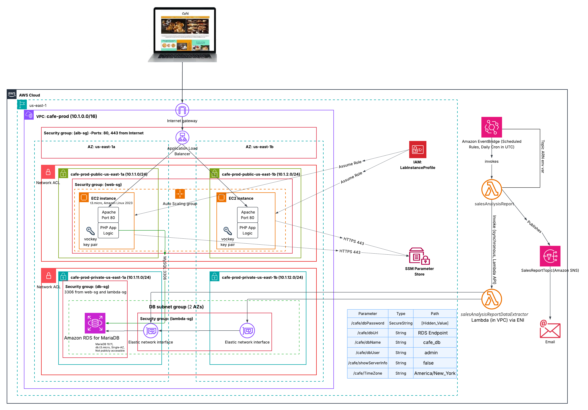
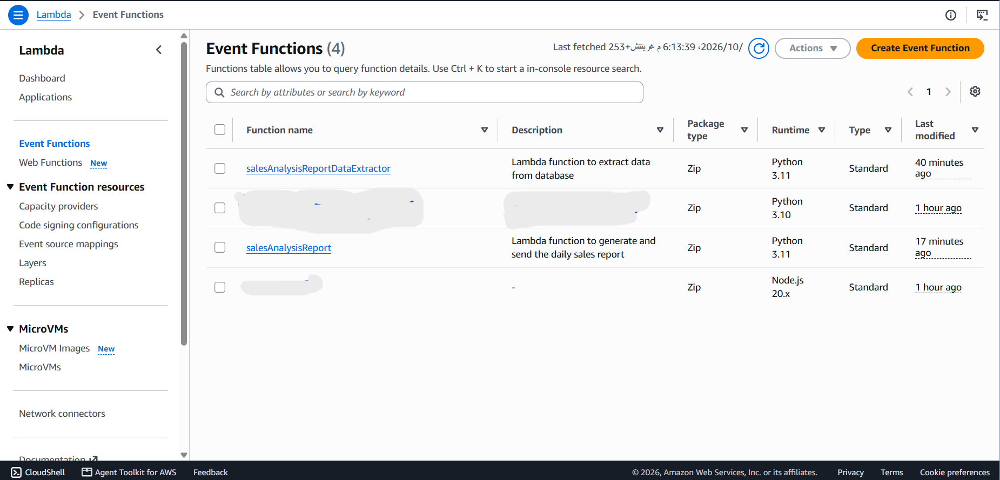
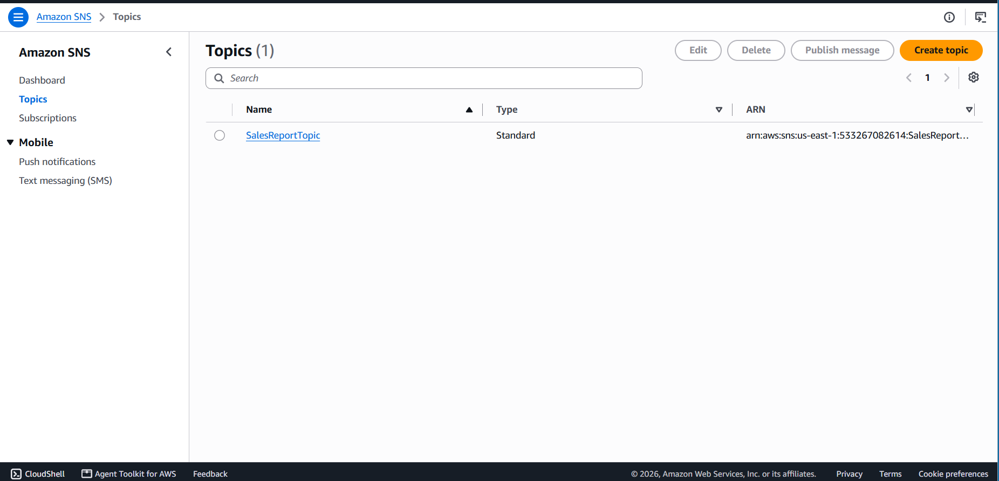
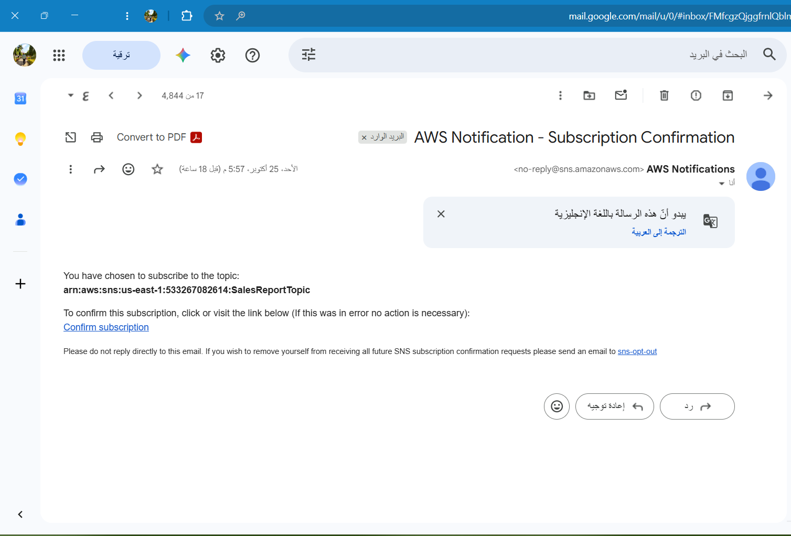
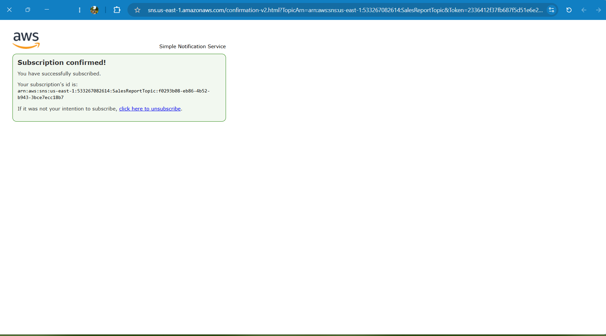
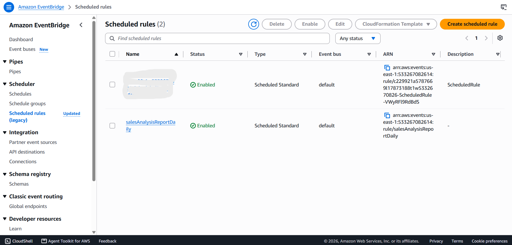
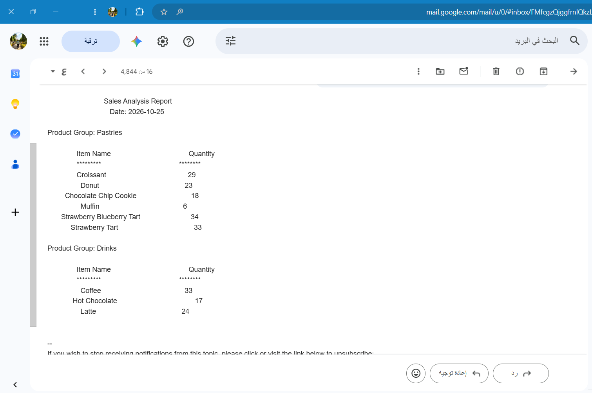

# V6 – Serverless Sales Reporting with Lambda, SNS and EventBridge

**Business reason:** Add reporting capabilities while reducing the operational and
maintenance burden, improving performance, and reducing costs.

## Architecture



```
EventBridge scheduled rule (daily, cron in UTC)
        │ invoke
        ▼
salesAnalysisReport            (Lambda, outside the VPC)
        │ invoke (synchronous)                │ Publish
        ▼                                     ▼
salesAnalysisReportDataExtractor      SNS topic "SalesReportTopic"
(Lambda, in the VPC private subnets)          │
        │ MySQL :3306                         ▼
        ▼                              Email subscription (admin)
RDS MariaDB (café orders and products)
```

## Why this design

- **Reporting leaves the web tier.** Generating reports on the web servers competes with
  customer traffic. A Lambda function runs only when scheduled, so there is no
  instance running 24/7 for a task that takes seconds.
- **Two functions, because of networking.**

| Function | Placement | Reason |
|---|---|---|
| `salesAnalysisReportDataExtractor` | Inside the VPC (private subnets) | Must reach the RDS database, which lives in a private subnet |
| `salesAnalysisReport` | Outside the VPC | Needs SNS and the Lambda API. A function inside a VPC has no internet access without a NAT Gateway or VPC endpoints, which add hourly cost |

  The orchestrator calls the extractor through the Lambda API, receives the data,
  formats the report and publishes it to SNS. No NAT Gateway or endpoint is needed.
- **Database access uses security groups.** The extractor has its own security group,
  and the database security group (`db-sg`) gets one extra inbound rule on port 3306
  whose source is that group, the same pattern used for `web-sg`.

## Components

| Component | Configuration |
|---|---|
| Lambda `salesAnalysisReportDataExtractor` | Python 3.11, VPC with the two private subnets, dedicated security group, 128 MB, 30 s timeout |
| Lambda `salesAnalysisReport` | Python 3.11, outside the VPC, 128 MB, 30 s timeout, environment variable `topicARN` |
| SNS topic `SalesReportTopic` | Standard topic with an email subscription |
| EventBridge scheduled rule | Daily cron expression (UTC) targeting `salesAnalysisReport` |

## Setup steps

1. **Extractor function:** create `salesAnalysisReportDataExtractor` (Python 3.11), attach it
   to the VPC, the private subnets and its security group, upload the package, set the
   handler, 128 MB memory and a 30 s timeout.
2. **Database access:** add an inbound rule on the database security group for MySQL/Aurora
   (3306) with the extractor's security group as the source.
3. **Report function:** create `salesAnalysisReport` (Python 3.11) outside the VPC, upload
   the package, set the handler, memory and timeout.
4. **SNS topic:** create `SalesReportTopic` (Standard) and add its ARN to the report
   function as the environment variable `topicARN`.
5. **Email subscription:** subscribe the admin email to the topic and confirm it from the
   confirmation message.
6. **Test:** run the report function once with the default test event and check the inbox.
7. **Schedule:** create an EventBridge scheduled rule with a daily cron expression (UTC)
   whose target is `salesAnalysisReport`.

## Result

The admin receives a daily email listing the quantity sold per product, grouped by
product group (pastries and drinks), which shows the best sellers for ingredient planning
and for measuring promotions.

| | |
|---|---|
| Lambda functions |  |
| SNS topic |  |
| Subscription confirmation email |  |
| Subscription confirmed |  |
| Scheduled rule (EventBridge) |  |
| Daily sales report received by email |  |

## Deployment note

This version was created through the AWS Console, not Terraform. The function code is
the provided package and is not stored in this repository.

## Limitations and next steps

- **Not Infrastructure as Code.** In Terraform it would be two `aws_lambda_function`
  resources, an `aws_sns_topic` with `aws_sns_topic_subscription`, an
  `aws_cloudwatch_event_rule` with a target and `aws_lambda_permission`, and a rule from
  the extractor's security group to `db-sg`.
- **The email subscription must be confirmed manually,** even when created by code.
- **Database credentials in the extractor.** A function inside a VPC without internet
  cannot call SSM or Secrets Manager. Production would add a VPC endpoint for the secrets
  service or use RDS IAM authentication.
- **No failure alerting.** A CloudWatch alarm on the Lambda `Errors` metric and a
  dead-letter queue would reveal a report that silently stopped.
- **The report lists quantities per product,** it does not rank them. Adding a "top
  product" line (sorted by quantity) would make the best seller explicit.
- **Schedule is in UTC;** convert to local time when choosing the send time.